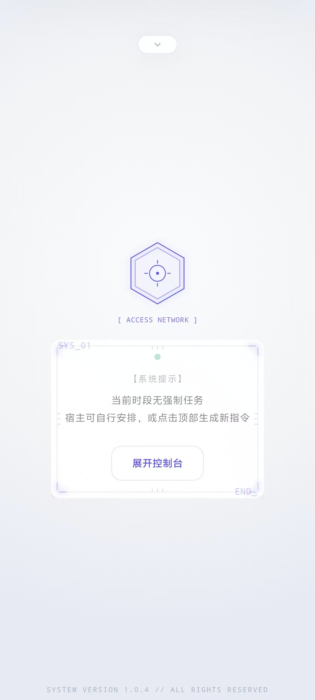
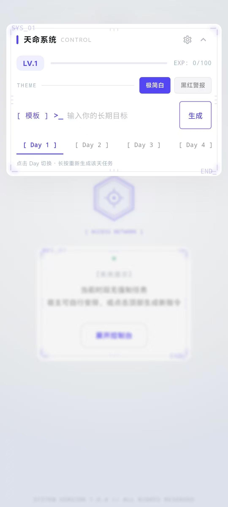
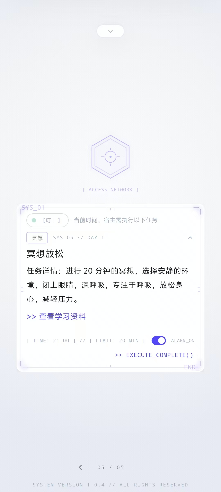
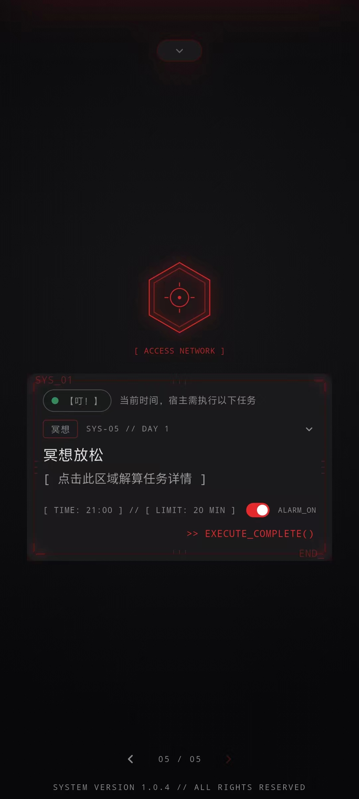
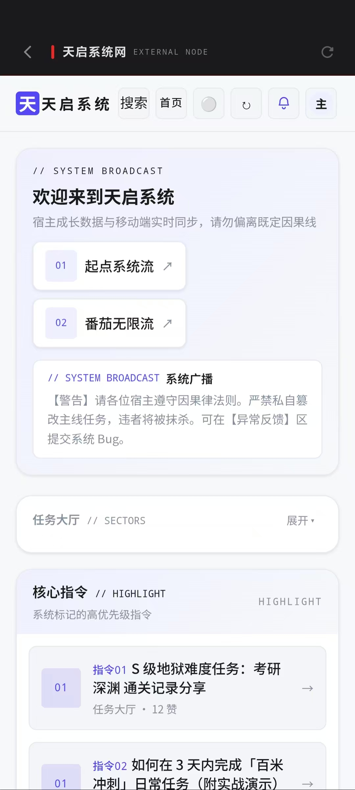
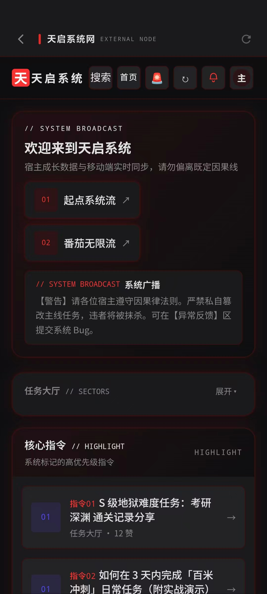

# 【天启】全栈 AI 习惯养成生态 (APOCALYPSE SYSTEM)

> `SYS.BOOT // TIANQI SYSTEM v1.0` — AI 驱动的移动端习惯养成 App + HUD 科技风云端交流中枢。


```text
+--------------------------------------------------------------+
|  TIANQI SYSTEM // APOCALYPSE PROTOCOL                        |
|  STATUS : ONLINE       NODE : CN-HANGZHOU                    |
|  MISSION: 用 AI 把「想变好」拆成今天能做完的一步              |
+--------------------------------------------------------------+
```

---

## // 01 项目简介

**一句话**：一个把宏大目标拆解为每日可执行指令、并用 JWT 打通 App 与云端的全栈习惯养成生态。

- **App 端**：任务聚焦卡、等级 / 经验 / 连击、每日唤醒提醒、黑红双主题、内嵌论坛入口。
- **Web 端**：天启系统风格的任务大厅、主线推演、资源置换、异常反馈四个分区。

---

## // 02 核心功能

| 模块 | 说明 |
| --- | --- |
| **AI 任务拆解** | 接入智谱 GLM-4，输入目标即返回结构化 JSON 指令（任务标题、时长、编号），避免大段自由文本无法解析。 |
| **跨端 JWT 状态同步** | App 登录后持有 Access/Refresh Token；`POST /api/v1/sync_status/` 全量覆盖等级、经验、连击，`GET /api/v1/user_info/` 只读回读，Web 端与 App 数据一致。 |
| **防幻觉机制** | Prompt 强约束输出 schema + 客户端逐字段校验 + 失败兜底本地预设指令；AI 不可用时功能降级但不断链。 |
| **黑红双主题** | 极简白 / 黑红警报两套调色板，由 `ThemeProvider` 驱动全站刷新，含自定义绘制的呼吸雷达节点与 HUD 弹窗。 |
| **等级与连击** | 经验满 100 自动升级，当日完成任务累积 streak，跨天未完成则重置；本地缓存 + 云端双向校验。 |
| **每日唤醒** | `flutter_local_notifications` 定时提醒，支持开机恢复与自定义时间选择器。 |
| **内嵌交流中枢** | WebView 加载论坛 Web 端，登录态复用，任务执行间隙无缝进入社区。 |

---

## // 03 技术栈 (Tech Stack)

| 领域 | 选型 |
| --- | --- |
| 移动端 | Flutter 3 / Dart 3、provider、dio、flutter_secure_storage、webview_flutter |
| 后端 | Django 5 + Django REST Framework、SimpleJWT、Gunicorn + Nginx |
| Web 前端 | Vue 3 + TypeScript + Pinia + Vue Router + TailwindCSS + Vite |
| 数据库 | MySQL 8（本地可回落 SQLite 快速验证） |
| AI 能力 | 智谱 GLM-4（`/api/paas/v4/chat/completions`） |
| 设计语言 | HUD 科技风：等宽字体、1px 边框、极少圆角、状态灯、暗红光晕 |

---

## // 04 架构说明

```text
┌──────────────────┐        JWT Bearer         ┌──────────────────┐
│  Flutter App     │  ───────────────────────▶ │  Nginx :80       │
│  (Android/iOS)   │                           │  /api/ → Gunicorn│
│                  │  ◀─── JSON 状态同步 ─────  │  /     → Vue dist│
└────────┬─────────┘                           └────────┬─────────┘
         │                                              │
         │ HTTPS (GLM-4)                                │ ORM
         ▼                                              ▼
┌──────────────────┐                           ┌──────────────────┐
│  智谱 GLM API    │                           │  MySQL 8         │
└──────────────────┘                           └──────────────────┘
```

**通信逻辑**

1. App 首次启动进入登录页，`POST /api/token/` 换取 Access / Refresh Token，存入 `flutter_secure_storage`。
2. `dio` 拦截器为每次请求注入 `Authorization: Bearer <access>`；收到 401 则清空 Token 并回跳登录页。
3. 完成任务后本地立即更新 UI，再异步 `POST /api/v1/sync_status/` 做全量覆盖写入；失败只提示，不阻塞本地进度。
4. Web 端登录同一账号，读取 `GET /api/v1/user_info/` 渲染头像旁的 LV / EXP，实现跨端一致。
5. AI 请求由 App 直连 GLM，API Key 通过 `--dart-define=GLM_API_KEY=...` 注入，绝不写入仓库。

**目录结构**

```text
TianqiSystem_Ecosystem/
├── tianqi_system_app/          # Flutter App
│   ├── lib/
│   │   ├── screens/            # 登录、主界面、论坛 WebView
│   │   ├── widgets/            # HUD 卡片、雷达节点、弹窗外壳
│   │   ├── services/           # API、AI、Token、通知
│   │   └── providers/          # 主题状态
│   └── android/                # 图标、Manifest、签名配置
└── anime-forum/
    ├── backend/                # Django + DRF
    │   ├── apps/users/         # 用户属性、同步接口
    │   ├── apps/forum/         # 分区、帖子
    │   └── seed_cloud.py       # 线上数据重建脚本
    └── frontend/               # Vue3 + TailwindCSS
```

---

## // 05 界面预览

### 5.1 App · 极简白

<table>
  <tr>
    <td align="center"><br><sub>空闲状态 / ACCESS NETWORK</sub></td>
    <td align="center"><br><sub>控制台展开 / AI 指令生成</sub></td>
    <td align="center"><br><sub>任务执行 / EXECUTE_COMPLETE()</sub></td>
  </tr>
</table>

### 5.2 App · 黑红警报

<table>
  <tr>
    <td align="center"><br><sub>任务执行 / ALERT MODE</sub></td>
  </tr>
</table>

### 5.3 Web · 极简白 / 黑红警报

<table>
  <tr>
    <td align="center"><br><sub>极简白 / 首页</sub></td>
    <td align="center"><br><sub>黑红警报 / 首页</sub></td>
  </tr>
</table>

---

## // 06 本地运行指南

### 6.1 后端（Django + MySQL）

```bash
cd anime-forum/backend

# 1. 虚拟环境
python -m venv .venv
source .venv/bin/activate          # Windows: .venv\Scripts\activate

# 2. 依赖与配置
pip install -r requirements.txt
cp .env.example .env               # Windows: copy .env.example .env
# 编辑 .env：DJANGO_SECRET_KEY / DB_* / CORS_ALLOWED_ORIGINS

# 3. 建表并注入初始数据
python manage.py migrate
python manage.py seed_apocalypse   # 本地：四大分区 + 初始帖

# 4. 启动
python manage.py runserver 0.0.0.0:8000
```

### 6.2 Web 前端（Vue3 + Vite）

```bash
cd anime-forum/frontend
npm install
npm run dev                        # 默认 http://localhost:5173
npm run build                      # 产物输出到 dist/
```

### 6.3 移动端（Flutter）

```bash
cd tianqi_system_app
flutter pub get
flutter run --dart-define=GLM_API_KEY=<你的智谱Key>

# Release 打包（签名读取 android/key.properties）
flutter build apk --release
```

> 本地联调时把 `lib/services/api_service.dart` 中的 `host` 临时改为 `http://10.0.2.2:8000`（Android 模拟器访问宿主机）。
> 线上部署可执行 `anime-forum/deploy.sh`，并运行 `seed_cloud.py` 重建云端数据。

---

## // 07 安全约定

- `.env`、`db.sqlite3`、`*.jks`、`key.properties` 全部由 `.gitignore` 拦截，**严禁入库**。
- GLM API Key 只通过 `--dart-define` 注入，代码中不出现明文。
- 切换 HTTPS 后应移除 `AndroidManifest.xml` 中的 `android:usesCleartextTraffic="true"`。

```text
// END OF TRANSMISSION
// SYSTEM STATUS: STABLE
```
