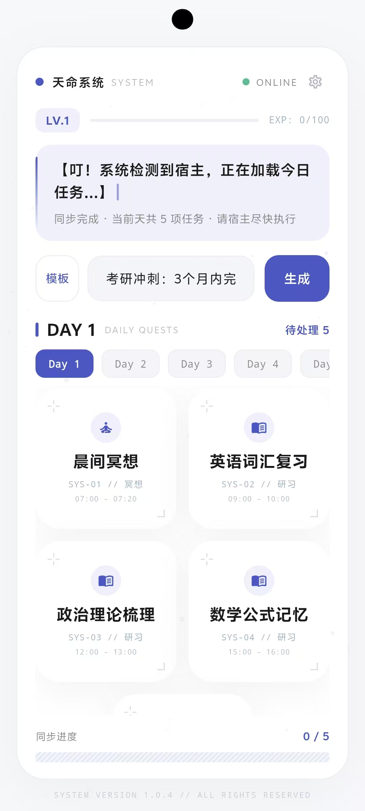
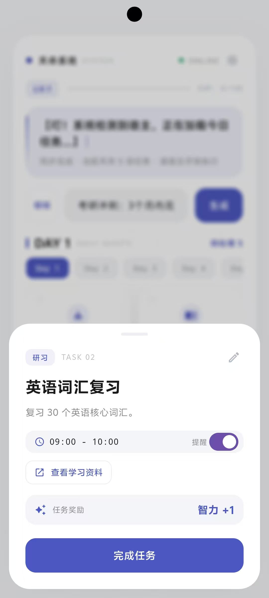
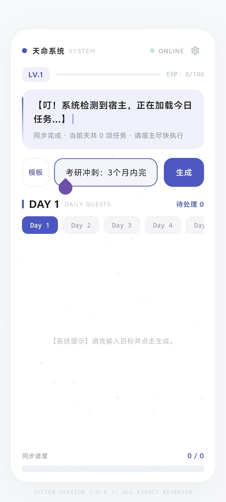
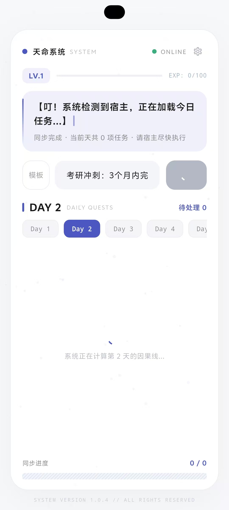
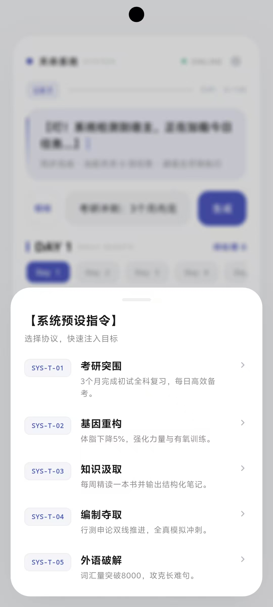

# 【天启】AI 驱动的系统化习惯养成 App

> 一款把长期目标变成「系统流」每日任务的 Flutter App：输入目标，AI 像穿越系统一样为你拆解 7 天可执行任务。

## 项目简介

「天启」是一款 AI 驱动的系统化习惯养成 App。你只需输入一个长期目标（如考研、减脂、读书），它就会以「系统」的口吻把目标拆解成 7 天的每日任务，配合等级、经验与连击机制，把坚持变成一场升级游戏。

## 📱 界面展示

| 主界面（Day 1 任务） | 任务详情 |
| --- | --- |
|  |  |

| 首次启动空状态 | Day 切换加载中 |
| --- | --- |
|  |  |

| 目标模板 | |
| --- | --- |
|  | |

## 核心亮点

- **AI Prompt 工程**：为智谱 GLM-4-Flash 定制 System Prompt，强制约束任务数量（每天 4～5 个）、时间范围（07:00–23:00）、时间不重叠、返回纯净 JSON，并对数量异常/解析失败自动重试与本地降级。
- **按需加载 + 自动持久化**：从 Day 1 开始，切到哪一天才请求哪一天；生成成功即把分天任务与目标写入 `SharedPreferences`（`cached_day_tasks`），重启后直接恢复任务、上次所在天与完成状态，不重复消耗 API。
- **底层通知**：基于 `flutter_local_notifications` + `timezone` 的 `zonedSchedule` 每日唤醒提醒，支持 Android 13+ 通知权限申请，App 退到后台或被杀掉也能准时收到。
- **极简 UI**：浅色科技风，2/3 列自适应正方形任务卡，HUD 十字准星与等宽字体细节，打字机系统提示、极缓的粒子背景，无多余按钮与干扰。
- **游戏化反馈**：完成任务 +10 EXP，满 100 升级并触发全屏微光，记录当天连击；长按 Day 标签可单独重新生成该天任务。

## 技术栈

| 类别 | 技术 |
| --- | --- |
| 框架 / 语言 | Flutter · Dart |
| AI 能力 | 智谱 GLM-4-Flash API（`http`） |
| 本地存储 | SharedPreferences |
| 通知 | flutter_local_notifications · timezone · flutter_timezone |
| 其他 | url_launcher（学习资料跳转） |

## 运行方式

### 环境要求

- Flutter SDK（Dart `^3.13.7`）
- Android 设备 / 模拟器（Android 13+ 需授予通知权限）

### 步骤

```bash
# 1. 克隆仓库
git clone https://github.com/<your-name>/tianqi_system_app.git
cd tianqi_system_app

# 2. 安装依赖
flutter pub get

# 3. 运行（通过 dart-define 注入 API Key，不会写进代码）
flutter run --dart-define=GLM_API_KEY=你的Key
```

> 前往 [智谱开放平台](https://open.bigmodel.cn/) 获取 API Key。
> 未传入 `GLM_API_KEY` 时，App 仍可正常运行，会使用本地预设任务作为降级数据，方便先预览界面。

## 目录结构

```text
lib/
├── main.dart                 # 入口：沉浸式全屏、通知初始化
├── theme.dart                # 浅色主题与设计变量
├── models/
│   └── system_task.dart      # 任务模型（含 JSON 序列化）
├── services/
│   ├── ai_service.dart       # GLM-4-Flash 调用与解析兜底
│   ├── host_state_store.dart # 等级/经验/完成记录/任务缓存持久化
│   └── notification_service.dart # 每日唤醒提醒
├── screens/
│   └── system_home_screen.dart # 主界面与状态管理
└── widgets/                  # 任务卡、详情面板、模板、背景等组件
```

## 说明

- 本项目使用 `--dart-define` 在编译期注入密钥，请勿把真实 Key 写进代码或提交到仓库。
- 任务数据首次生成后自动保存，退出 App 再打开会直接恢复到上次的天数与任务。
- 只有在输入框修改目标并重新点击「生成」时，才会开启新档并清空任务缓存、等级、经验与完成记录。
